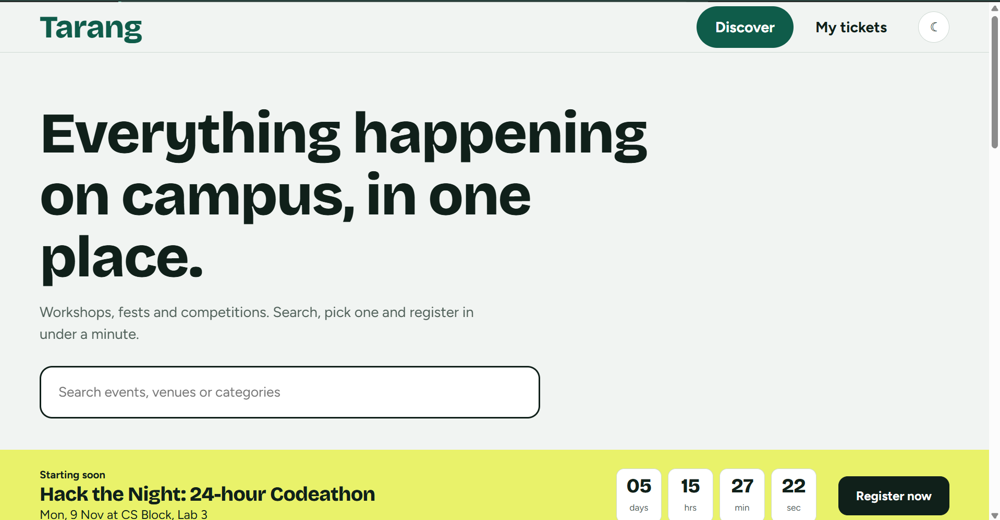
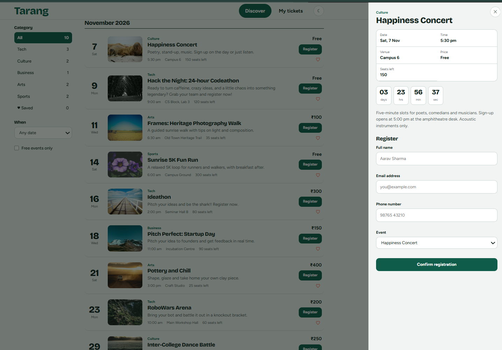
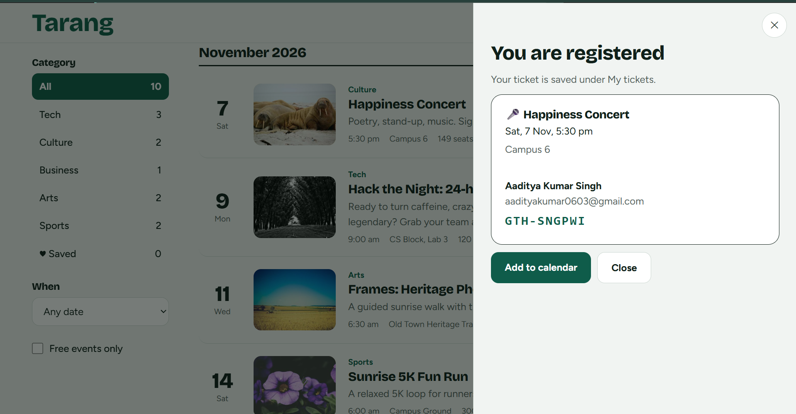
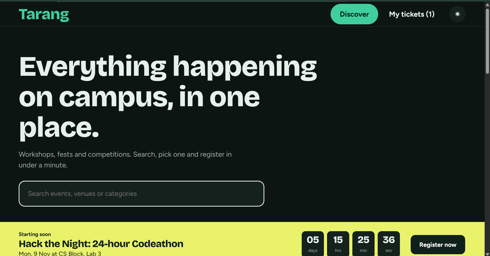

# Tarang: Responsive Event Management Website

**Made by:** Aaditya Kumar Singh | Kalinga Institute of Industrial Technology | Btech CSE 5th Semester  
**Task:** K Explore, Web Designing: Design and Develop a Responsive Event Management Website

**Live site:** YOUR-VERCEL-LINK  
**GitHub repository:** https://github.com/Web-pirate05/tarang



## About the project
Tarang is a single-page event platform. Visitors can browse upcoming events on a dated timeline, search and filter them, open any event in a slide-in panel to read the details, and register through a validated form. After registering, they get a ticket with a unique ID that is saved under "My tickets".

## Features

| Requirement | How it is implemented |
|---|---|
| Hero section | Search-first hero with a "starting soon" spotlight strip and a live countdown |
| Upcoming and featured events | Timeline grouped by month; the nearest featured event is shown in the spotlight |
| Event cards | Date, image, category, title, time, venue, seats left, price and short description |
| Browse, search and filter | Live search, category sidebar with event counts, date range (next 7 or 30 days), free-events-only toggle and saved events |
| Event details | Slide-in panel (bottom sheet on phones) with date, time, venue, price, seats left, countdown and full description |
| Registration form | Name, email, phone number and selected event |
| Form validation | JavaScript validation on blur, while typing after an error, and on submit, with a specific message for each field |
| Confirmation message | Ticket with a unique ID and an "Add to calendar" link after a successful registration |
| Responsive design | Works on mobile, tablet and desktop; the sidebar becomes a scrollable chip bar on small screens |

### Bonus features
- Dark and light mode (remembers your choice)
- Countdown timers on the spotlight strip and every event
- Animations: hero entrance, sliding panel, button and row hover effects
- Local Storage for registrations, saved events and theme
- "My tickets" page where registrations can be viewed and cancelled
- Save events with a heart button

### Validation rules
- **Name:** letters, spaces and `. ' -`, 3 to 50 characters
- **Email:** standard `name@domain.com` format
- **Phone:** 10-digit mobile number starting with 6 to 9, optional `+91`
- **Event:** must be selected; sold-out events cannot be chosen
- The same email cannot register twice for the same event

## Technologies used
- **React 18** (components, hooks, state management)
- **Vite** (development server and build tool)
- **HTML5** and **CSS3** (Grid, Flexbox, CSS variables, media queries, animations)
- **JavaScript (ES6+)** for filtering, validation and Local Storage
- **Git and GitHub** for version control
- **Vercel** for deployment

## Screenshots
| Home | Event details panel |
|---|---|
|  |  |

| Registration | Mobile view | Dark mode |
|---|---|---|
|  |  |  |

## Project structure
```
tarang/
├── index.html
├── package.json
├── vite.config.js
├── .github/workflows/deploy.yml
└── src/
    ├── main.jsx          entry point
    ├── App.jsx           state, filtering and page layout
    ├── components.jsx    Countdown, EventRow, Drawer, Stub, Tickets
    ├── hooks.js          useLocalStorage and useCountdown hooks
    ├── data.js           event data
    └── index.css         design tokens, layout, responsive rules, dark theme
```

## How to run locally
1. Install [Node.js](https://nodejs.org) (version 18 or newer)
2. Clone the repository and open the folder
   ```bash
   git clone https://github.com/Web-pirate05/tarang.git
   cd tarang
   ```
3. Install dependencies and start the site
   ```bash
   npm install
   npm run dev
   ```
4. Open the link shown in the terminal (usually http://localhost:5173)

To create a production build, run `npm run build`.

## Deployment
The site is deployed on **Vercel**. The GitHub repository is connected to Vercel, so every push to the `main` branch redeploys the site automatically. Settings used: framework Vite, build command `npm run build`, output directory `dist`.

## How the main parts work
- **Filtering:** the event list is computed from the search text, category, date range and free-only toggle, then sorted by date and grouped by month.
- **Registration:** the form validates every field, checks for duplicates and sold-out events, then saves a registration with a unique ID.
- **Local Storage:** registrations, saved events and the theme are stored in the browser through a reusable `useLocalStorage` hook.
- **Event dates:** dates in `data.js` are set relative to today, so the demo always shows upcoming events.

## Notes on registration data
Registrations are saved in the browser's Local Storage. They stay after a page refresh, but they are specific to one browser on one device and are not sent to a server. Clearing browser data removes them.

## Challenges and what I learned
- WRITE 3 TO 4 POINTS ABOUT WHAT YOU ACTUALLY FOUND HARD OR LEARNED
- For example: building the filters, making the layout work on phones, fixing a bug, deploying to Vercel

## Possible improvements
- A backend and database so registrations sync across devices
- Email confirmations
- An admin panel to add and manage events
- Downloadable calendar (.ics) files